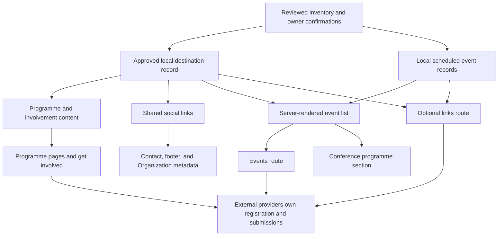

# IHSAAN public website Linktree integration plan

Status: historical proposal from 12 October 2026. An initial implementation
followed. See the [implementation report](LINKTREE-IMPLEMENTATION-REPORT.md).
This plan records the original research and alternatives, not current tasks or
instructions. Routes and publication decisions have changed since it was written.
Use the [codebase map](CODEBASE_MAP.md) and
[contributor guide](../CONTRIBUTING.md) for current development guidance.

Prepared on 12 October 2026. Evidence is in the [complete Linktree inventory](LINKTREE-INVENTORY.md).
The inventory contains all 19 profile destinations, exact URLs, destination checks, five event schedules, and two supplementary application links.

## Overview

Make each IHSAAN destination discoverable through the page that explains its purpose. Students should find guides, mentorship, events, and community access without searching a separate Linktree. Professionals should find the relevant network or volunteering route.

Use the existing Next.js public site for explanations and navigation. Keep applications, registration, mentorship booking, community admission, and volunteer applications on their existing external services. This plan does not add accounts, a database, a CMS, payments, or a form-processing backend.

The recommended first implementation adds one page, `/events`, and improves existing programme, involvement, contact, and footer links. A second page, `/links`, is useful only if IHSAAN wants a first-party replacement for the Instagram Linktree.

The opportunities tracker needs an explicit restoration decision. The alumni signup needs a working replacement. Neither becomes a live CTA just because it appears in the source profile.

## Scope and acceptance criteria

The original research deliverable was this plan and the inventory. Its proposed
scope below is retained as historical context, not approval for new changes.

A future implementation satisfies this plan when:

- Every inventory ID has an approved website placement or a documented publication hold.
- Link labels describe the actual action and destination.
- Users can find events, career support, involvement routes, and approved social profiles from the website.
- Duplicate placements consume the same destination URL rather than separate copies.
- Past events do not remain labelled "Upcoming" after their end date.
- The public website does not collect application or registration data itself.
- Canonicals use `https://ihsaan.network`, and new routes appear in the relevant discovery documents.
- Tests cover actual link destinations, expiry behavior, and intentionally hidden content.

The architecture baseline is this checkout, inspected through `README.md`, `docs/context.md`, `docs/CODEBASE_MAP.md`, and `docs/IHSAAN-DESIGN.md`.
The live homepage currently differs from the checkout. Its membership forms are useful discovery evidence, but deployment parity is not established.
Shared documentation is now tracked under `docs/`. Do not include local agent
logs or machine-specific evidence in documentation commits.

## Existing architecture and gaps

| Area | Existing ownership | Observed gap |
| --- | --- | --- |
| Navigation and shared destinations | `src/content/site.ts`, `NAV_LINKS`, `GET_INVOLVED`, `MEMBER_PORTAL`, `SOCIAL_LINKS` | Social links contain Instagram and LinkedIn only. No events route, community form, alumni signup, or volunteer openings link. |
| Programme descriptions and actions | `src/content/programmes.ts`, `PROGRAMME_PAGES`, `ProgrammeAction` | Calendar, My Muslim Mentor, and Careers Essentials already exist. Haqqathons' own site and the reflection article do not. |
| Programme rendering | `src/app/programmes/[slug]/page.tsx` | Static slugs come from `PROGRAMME_PAGES`. The existing `ProgrammeEvent` holds display strings for past programme events, not live scheduled events. |
| Get involved | `src/app/ticket/page.tsx`, `INVOLVEMENT_ROUTES`, `RouteSwitcher`, `InvolvementCards` | Students go to programmes. Professionals and organisations go to contact. Membership and community applications are not direct actions. |
| Contact and footer | `src/app/contact/page.tsx`, `src/components/site-footer.tsx` | Shared social data already reaches both. Footer icons recognize only Instagram and LinkedIn. |
| Tracker | `next.config.mjs`, `src/content/legacy-routes.mjs` | `/programmes/opportunities-tracker` temporarily redirects to `/programmes`. The programme is absent from current content. |
| SEO and discovery | `pageMetadata`, `sitemap.ts`, `llms.txt/route.ts`, root Organization JSON-LD | New route entries are manual. Organization `sameAs` duplicates the two current social URLs. |
| Security and privacy | `next.config.mjs`, `src/app/privacy/page.tsx` | Strict same-origin CSP. Current privacy copy says there are no onsite forms, accounts, or analytics. |

Do not confuse the portal with an application. `MEMBER_PORTAL` is an existing entry to the separate member product at `https://portal.ihsaan.network`.

## Complete placement map

Inventory IDs below refer to exact destinations in [LINKTREE-INVENTORY.md](LINKTREE-INVENTORY.md). "New" denotes a proposed route, not an existing page.

| ID | Primary placement | Additional placement | Website label / behavior | New page needed? |
| --- | --- | --- | --- | --- |
| L01 | `/ticket` student membership section | Optional `/links` first action. Homepage get-involved CTA goes to `/ticket`. | "Apply for membership" only after S01 or another actual application route is confirmed. Do not send this action back to the homepage. Keep "Student portal" separate. | No. Use `/ticket`. |
| L02 | New `/events` academy event list | Optional `/links` timely events group | "Law Spring Week Academy", with date and online format. "View event on Luma" opens the existing event. | Recommended `/events`. No individual event page. |
| L03 | New `/events` academy event list | Optional `/links` while current | "Tech Spring Week Academy". Recheck before launch because it occurs on 12 October 2026. | Same `/events`. |
| L04 | New `/events` academy event list | Optional `/links` while current | "Finance Spring Week Academy", with date and online format. | Same `/events`. |
| L05 | New `/events` panel event list | `/ticket` alumni section can link to `/events` for networking events | "DCU ISoc Alumni Panel". Resolve the end-time conflict before publishing a time range. Preserve Luma's address gate. | Same `/events`. |
| L06 | New `/events` conference event list | `/programmes/career-conferences` upcoming conference section | "IHSAAN Ireland Career Conference 2026". Link to its Luma event rather than a generic calendar. | Same `/events`. |
| L07 | New `/events` permanent calendar action | Current conference and hackathon CTAs retain access to the calendar. Optional `/links`. | "View the full IHSAAN calendar". Use the clean Luma URL. | No page is technically required to add this link. `/events` gives it a clear local home. |
| L08 | Existing `/programmes/mentorship` primary action | `/ticket` student and professional support links. Optional `/links`. | Retain "Visit My Muslim Mentor". Do not promise completed matching or booking. | No. Already linked. |
| L09 | `/ticket` proposed alumni section | Optional `/links` community group, only after repair | "Join the alumni network" only with a verified replacement. Until then, use "Ask about the alumni network" linking to `/contact`, or omit the signup. | No. A separate alumni page is not justified by one broken form. |
| L10 | `/programmes/hackathons` related action | Optional `/links` career support group | "Visit Haqqathons". Keep the existing upcoming-events and partnership paths. | No. Reuse the hackathon programme page. |
| L11 | Restored `/programmes/opportunities-tracker`, only if approved | Programme index, offers carousel, `/ticket`, and optional `/links` after restoration | "Open the opportunities tracker". Do not advertise active vacancies from the empty extracted table. | Conditional restoration of an existing reserved route through the programme template. |
| L12 | Existing `/programmes/career-guides` primary action | `/ticket` student resources. Optional `/links`. | Retain "Access the guides" and its existing Notion URL. | No. Already linked. |
| L13 | `/programmes/career-guides` reflections section | Optional `/links` career support group | "Read a Civil Service internship reflection". Explain that the article opens on Notion. Do not call this a blog index. | No for the external article. `/blog` is a later content project. |
| L14 | `/ticket` community section | `/contact` community help; optional `/links` | "Apply to join the WhatsApp community". Explain that a Google Form opens and admission is a separate process. | No. This is an intake form, not a direct WhatsApp invite. |
| L15 | Existing contact and footer social links | Optional `/links` social group | Retain "Instagram" and the existing normalized URL. | No. Already linked. |
| L16 | Existing contact and footer social links | Optional `/links` social group | Retain "LinkedIn". Verify in an ordinary browser before claiming it is available. HTTP 999 is not grounds for deleting it. | No. Already linked. |
| L17 | Contact and footer `SOCIAL_LINKS`, after account confirmation | Optional `/links` social group | "TikTok". Add an actual visible icon or text fallback in the footer. | No. |
| L18 | Contact and footer `SOCIAL_LINKS` | Optional `/links` social group | "YouTube". Add an actual visible icon or text fallback in the footer. | No. |
| L19 | `/ticket` volunteer section | `/contact` targeted volunteering action; optional `/links` | "View volunteer openings". State that these are unpaid volunteer roles. | No. Not a new jobs product. |

Supplementary candidates S01 and S02 belong to `/ticket`, not the programme registry. S02 can add "Join the professional network" beside the existing mentor and speaker routes after confirmation.
Do not replace the professional-network form with My Muslim Mentor, or treat the community form as the membership application.

Faithful Talent remains at `/programmes/faithful-talent` with its current partnership and involvement CTAs. No direct Faithful Talent application URL was collected.

## New-page decisions

| Route | Recommendation | Reason and dependency |
| --- | --- | --- |
| `/events` | Add in the recommended implementation. | Academies and alumni panels are not all career conferences or hackathons. A shared event index avoids placing unrelated events under the wrong programme. |
| `/links` | Optional. Add only if a first-party bio landing page is wanted. | A compact mobile page can preserve Linktree's short path to an action. Replacing the Instagram bio URL is a separate external action requiring approval. |
| `/programmes/opportunities-tracker` | Restore only after approval and content review. | The route is intentionally hidden. Restoration requires coordinated content, redirect, discovery, and test changes. |
| `/events/[slug]` | Do not add initially. | The five Luma pages already own details and registration. Duplicating them adds stale-content risk without removing the external registration step. |
| `/alumni`, `/community`, `/volunteer` | Do not add initially. | `/ticket` has room to explain these actions. Add a dedicated page later only for substantial programme content or distinct recurring journeys. |
| `/blog`, `/blog/[slug]` | Defer. | The collected "IHSAAN Blogs" link is one external article. Native publishing requires editorial ownership, author consent, article metadata, and content migration. |
| `/resources` or a standalone careers guide page | Do not add initially. | `/programmes/career-guides` already explains the resource and links to the full collection. |
| `/membership` | Do not add initially. | `/ticket` can explain application versus portal access. A separate page is justified only by confirmed membership rules or a fuller onboarding journey. |

### Alternatives and tradeoffs

| Approach | Benefit | Cost | Judgment |
| --- | --- | --- | --- |
| Existing-page links only, with an events section on `/ticket` | Smallest change. No new routes. | Events have a weak permanent home and are less discoverable. | Valid minimal option if the priority is only repairing access to links. |
| `/events` plus existing-page improvements | Covers all event types and keeps resources within current programmes. | Adds one route and scheduled-event content. | Recommended. |
| Add `/links` as well | Direct first-party replacement for the social bio landing page. | Adds another view of the same destinations that must not drift. | Useful if IHSAAN wants to retire Linktree. |
| Native forms, CMS, full blog, native job board, and native booking | More onsite control. | Creates several separate products, privacy obligations, and integration work. | Outside this request. |

## Page content and navigation

### `/events`

Use a compact introduction, not a large video hero. The first screen should reveal the next event or the full-calendar action.
Display a chronological "Upcoming events" list with event title, short description, local date and time zone, format or public city, and a Luma link.
Separate academy, panel, and conference labels. Five events do not need interactive filters.

Keep a permanent "View the full IHSAAN calendar" action above or below the list. Luma may contain events absent from this snapshot, so this remains the fallback when the curated list is empty.
Provide an honest empty state, "No upcoming events are listed here. Check the IHSAAN calendar for the latest schedule."
Past entries may remain in a clearly labelled archive with "View past event" links, not registration CTAs.

Add "Events" to `NAV_LINKS` and verify the existing desktop header still fits. The footer inherits navigation links.
If the extra item crowds the capsule navigation, retain an events link in the programmes index and footer rather than redesigning the header without approval.
On the homepage, add an evergreen "View events" action near programme discovery instead of a date-sensitive list. This preserves its static rendering.

### `/ticket`

Keep `/ticket` as the canonical get-involved route. Do not rename it during this work.
Retain the current students, professionals, and organisations overview and add a server-rendered action section below it.

The section covers:

- Student membership, after the application destination is confirmed. Explain application versus portal access.
- Professional network access, after S02 is confirmed. Keep mentoring and speaking enquiries separate.
- WhatsApp community intake, with a short explanation of the external Google Form.
- Alumni participation. Use a contact fallback until the signup is repaired.
- Volunteering, with unpaid-role wording and the Notion openings action.

Use stable section IDs such as `membership`, `community`, `alumni`, and `volunteer` if other pages need deep links.
These are proposed IDs, not current anchors.
Do not replace the organisation partnership route or silently change all professional involvement into volunteering.

### Programme pages and contact

Add an optional `relatedLinks` collection to the existing `ProgrammePage` data and render it through the common programme template.
Use it for Haqqathons on the hackathon page and the reflection article on the career-guides page. This preserves the existing primary and secondary CTAs.
The conference page can show approved conference events through the shared event list, separately from its historical signup statistics.

Contact remains a help and enquiries page. Link community and volunteer enquiries to the relevant `/ticket` anchors instead of making people guess which form they need.
The footer and contact page use the same approved social destinations. Extend the icon renderer or provide visible text for TikTok and YouTube. Its current unknown-label fallback returns `null`.

### Optional `/links`

Render a mobile-first list with the existing wordmark, a short explanation, and grouped actions. Retain the root layout, skip link, header, and footer initially.
Use `Container`, `SectionHeading`, and existing link styles. Avoid a new link-tree component library or third-party widgets.

Proposed order is membership, timely events, career support, community and involvement, then social accounts.
Use internal programme routes for mentorship, guides, hackathons, and the tracker so visitors can read the context. Direct external event links are appropriate for a low-friction registration journey.
Keep the accurately named external reflection link until native articles exist.

Do not display unavailable alumni signup, unapproved tracker access, unconfirmed membership routes, or expired event registration CTAs.
Keep a full-calendar action even when there are no listed events.

## Target architecture

### Key concepts and data ownership

Keep public content local and typed. The documentation owns exact source URLs, collection provenance, failed destination checks, and publication holds. Runtime content contains only approved destinations.

| Proposed data shape | Ownership | Contents and constraints |
| --- | --- | --- |
| `PUBLIC_DESTINATIONS` | New `src/content/links.ts` | Small readonly record of approved external destinations, keyed by stable names such as `eventsCalendar`, `myMuslimMentor`, and `whatsappCommunity`. Each entry has an `href` and an accurate label. Derive the destination-key type from the record. |
| `SOCIAL_LINKS` | Existing `src/content/site.ts` | Retain its `NavLink` interface and public export. Source its URLs from the approved destination record, rather than introduce a second social registry. |
| `ProgrammePage.relatedLinks` | Existing `src/content/programmes.ts` | Optional readonly `ProgrammeAction` list. Reuse the existing action shape and explicit `external` flag. |
| `PublicEvent` and `PUBLIC_EVENTS` | New `src/content/events.ts` | Stable event ID, title, summary, destination key, ISO start/end instants, IANA time zone, event kind, public location or online format, and editorial state such as scheduled or cancelled. Resolve the DCU end time before adding its complete record. |
| Involvement action content | Existing `src/content/site.ts` | A small explicit list for the new `/ticket` action section. Keep it distinct from the three current audience overview entries. Include only approved applications or honest contact fallbacks. |

Do not use one unstructured array as a substitute for programmes, events, and applications. These have different lifecycles.
Do not store an `isUpcoming` boolean. Derive upcoming, ongoing, and ended states from event instants and a supplied current time.
Keep Luma's admission status separate from date classification. A scheduled event does not prove that registration is open, approved, or free.

Do not add the broken alumni URL to active runtime content. It stays in the inventory until replaced and checked.
Application destinations, including S01 and S02, enter the registry only after IHSAAN confirms them.
Internal route paths remain ordinary Next.js links. A generic redirect service or `/go/[id]` tracking layer is unnecessary.

### Rendering and external boundaries

Server components render the destination links. The browser contacts Luma, Google Forms, Notion, Tally, or another provider only after the visitor follows an external link.
There is no Linktree request, provider scraping, or external form embed in the website's runtime or build.
Updating a URL or event schedule changes local content and ships through the normal review and deployment process.

### Event expiry and caching

Request-time server rendering is the recommended first version for `/events` and, if approved, `/links` when it lists timely events.
Use the existing Next.js route configuration to opt those routes into dynamic rendering. Read the current time on the server and pass it to a pure event-classification helper.
No network request is required to classify these five local event records.

If the conference page displays the same date-sensitive list, opt that detail route into request-time rendering as well. Because its template serves all programme slugs, this can affect every programme page.
The smaller alternative is to keep programme pages static and link to `/events` without inline scheduled cards. Prefer that alternative if preserving static programme rendering is important.

Keep the homepage date-independent and static. Do not evaluate time only during a production build and assume the resulting "Upcoming" label stays correct.
Already-open tabs can retain their rendered state until navigation or reload. This first version does not add a client timer.

Request-time classification removes expired promotion, but does not detect postponements, cancellations, or registration closure on Luma. Those need editorial updates.
A future feed integration would require separate approval, documented provider support, validation, failure behavior, and maintenance ownership.

### Where things live

All new paths below are proposed. Existing paths were inspected in this checkout.

| File | Planned responsibility |
| --- | --- |
| `src/content/links.ts` | New approved destination record. Import destinations where currently duplicated. |
| `src/content/events.ts` | New scheduled-event records. Keep the existing historical `ProgrammeEvent` data unchanged. |
| `src/lib/events.ts` | New pure event classification and chronological selection helper with an explicit clock argument. |
| `src/components/event-list.tsx` | New shared server-rendered event list, empty state, and appropriate past-event actions. |
| `src/app/events/page.tsx` | New events index, metadata, request-time event selection, and calendar fallback. |
| `src/content/site.ts` | Existing navigation, shared social links, involvement overview, and proposed involvement actions. Tracker carousel entry only if restored. |
| `src/content/programmes.ts` | Existing programme CTAs plus optional related links. Tracker copy only if restored. |
| `src/app/programmes/[slug]/page.tsx` | Related-link section. Optional conference-only scheduled list, with rendering tradeoff above. |
| `src/app/ticket/page.tsx` | Existing get-involved route plus application, community, alumni fallback, and volunteer actions. |
| `src/app/contact/page.tsx` | Social links and targeted guidance to the relevant involvement sections. |
| `src/app/page.tsx` or `src/components/sections.tsx` | Evergreen events discovery action. Select the existing owning section during implementation. |
| `src/components/site-footer.tsx` | TikTok and YouTube icon or text rendering. Existing footer navigation inherits "Events". |
| `src/app/layout.tsx` | Align Organization `sameAs` with approved social URLs. Do not include intake forms, event tickets, or arbitrary partners in `sameAs`. |
| `src/app/sitemap.ts`, `src/app/llms.txt/route.ts` | Add the approved new routes. Restored programmes already enter the sitemap through `PROGRAMME_PAGES`. |
| `src/app/privacy/page.tsx` | Explain newly linked application and community providers without claiming that this site processes their forms. |
| `next.config.mjs`, `src/content/legacy-routes.mjs` | Tracker restoration only. No CSP expansion for ordinary external links. |
| `src/app/links/page.tsx` | Optional bio landing page, from the same approved content and event records. |

The programme registry has `dynamicParams = false`. Restoring the tracker requires a `PROGRAMME_PAGES` entry so the route is generated, not just removing a redirect.
Also add its programme card to `PROGRAMMES` so the offers carousel and relevant discovery paths stay aligned.
Update the old `opportunities-tracker` legacy mapping to the restored programme. Decide separately when a permanent redirect is appropriate.

## Design, accessibility, security, and SEO

Follow `docs/IHSAAN-DESIGN.md` and existing site primitives. Use Poppins, IHSAAN Blue, purple and light-blue accents, generous spacing, flat surfaces, and restrained lists.
Do not copy Linktree's grey theme, promotional UI, cookie banner, or decorative assets.
On mobile, make event titles and action labels readable without truncation and preserve the existing accessible touch-target pattern.

Use descriptive link text and explain external applications beside the CTA. External does not automatically mean a new tab.
`ButtonLink` currently renders a plain anchor when `external` is true. Preserve that behavior unless a product decision says otherwise.
Links that intentionally use `target="_blank"`, such as current social links, retain `rel="noopener noreferrer"`.
Provide visible content for every footer social link, visible keyboard focus, semantic headings, and sufficient contrast in both themes.
Do not hide essential actions behind motion or a hover-only interaction.

Plain external navigation does not require new CSP allowlists. Keep forms as links so `form-action 'self'` and current script, frame, and connection restrictions remain intact.
Do not load social widgets, remote posters, calendar embeds, or Tally scripts.
If event artwork is needed, use approved local assets under `/media` rather than expanding remote image access.

Privacy copy should distinguish Google Forms and any repaired Tally signup from data submitted on this website.
External application forms can collect names, phone numbers, and other personal information. IHSAAN must confirm the forms' notices and admission processes before promoting them.
Do not add click analytics, attribution storage, cookies, or automatic forwarding of query parameters during this work.

Use `pageMetadata()` for `/events` and optional `/links`, with their actual paths and production canonicals.
Extend the sitemap, `llms.txt`, and SEO tests. Preserve production-only indexing and preview `noindex` behavior.
Use only confirmed social profiles in Organization `sameAs`.
Do not claim Event structured data, ticket pricing, admission availability, or native Article markup unless the implemented page supports accurate corresponding content.

## Implementation sequence and checks

This sequence is a proposal for a later approved implementation. It does not authorize commits, pushes, deployment, changes to Instagram, or deletion of Linktree.

### 1. Resolve destination and scope decisions

Confirm the membership and professional-network forms, replace the alumni 404, resolve the DCU time discrepancy, verify the two uncertain social profiles, and decide whether to restore the tracker.
Choose whether `/links` is wanted. Assign an editorial owner for event dates and external destination checks.
Recheck all five event schedules because several can expire before implementation starts.

Output is an approved set of destinations with explicit holds. A blocked destination does not prevent unrelated verified links from shipping.

### 2. Improve existing pages

Add the destination record and source existing shared URLs from it. Keep the existing exports and component APIs where possible.
Add the related-links section, involvement actions, contact guidance, approved social links, and footer renderers.
Update privacy provider references and Organization social metadata.

Verify that membership, community admission, volunteering, and portal access remain distinct actions. Check the actual rendered URLs, not just the presence of a label.

### 3. Add `/events`

Add event records, the pure clock-based selector, the event list, the route, and discovery links.
Update route metadata, sitemap, and `llms.txt`.
Start with local content and external Luma links. Do not build a scraper or a registration form.

### 4. Restore the tracker only if approved

Coordinate programme content, cards, redirect removal, legacy mappings, and discovery in one change.
If the tracker is not approved, leave both current hiding mechanisms intact and omit its active CTA from all new views.
Review the public destination for data exposure and usable role content. A reachable Notion introduction is not evidence of a populated, maintained board.

### 5. Add `/links` only if approved

Compose the page from approved destination and event records. Add metadata, sitemap, `llms.txt`, and rendering tests.
After deployment verification and separate approval, update the external Instagram bio URL. Retain Linktree until the new route is proven on mobile.

### Historical proposed coverage

The table below records the original proposal. For new coverage, follow the
current E2E-first policy in `CONTRIBUTING.md`. Do not add isolated helper or
unit tests. Use integration coverage only when E2E is disproportionate or cannot
reach the affected behavior, and state why.

| Check | Required behavior |
| --- | --- |
| Destination content tests | IDs and keys are unique. External URLs use HTTPS. Captured `fbclid` values do not enter runtime content. Unapproved or broken destinations are absent. |
| Get-involved rendering test | Membership points to the approved application, not `/`. Community points to the Google Form. Volunteering has unpaid-role context. Portal remains distinct. |
| Programme rendering tests | Existing mentorship and guides URLs remain correct. Haqqathons and the reflection have descriptive links. Existing partner actions remain available. |
| Event helper tests | Unsorted records sort chronologically. Future, ongoing, ended, and cancelled events have correct states. Exact start/end boundaries and UK/Ireland clock changes are covered with a supplied clock. |
| Events page test | Upcoming events link to their own Luma pages. Ended events do not show registration CTAs. Empty lists retain the calendar fallback. Dates and time zones are readable. |
| Footer and contact tests | Every approved social link has a visible icon or text and an accessible name. TikTok and YouTube do not produce empty anchors. |
| SEO tests | New canonicals, sitemap entries, and route descriptions are correct. Preview indexing rules remain unchanged. |
| Tracker tests | If hidden, it remains excluded and redirected. If restored, its slug, content, cards, sitemap, and legacy routes agree. |
| Optional bio page test | Every approved action resolves to the intended route or provider. Publication holds and expired promotions are omitted. |

Use repository scripts. Run the new focused tests first, then `bun run test:run` and `bun run lint`.
Run `bun run build` after stopping any dev server in the worktree. Verify route output and request-time behavior rather than treating compilation as proof of expiry handling.
Check mobile and desktop rendering, keyboard navigation, both themes, and external destinations without submitting forms.
For new event rendering, test with a controlled clock before, during, and after an event.

Before completion, review `git diff`, preserve unrelated changes, and check
documentation for whitespace errors and private machine details.
After an approved deployment, verify the actual apex pages, `www` canonical behavior, and destination links. The current live/check-out mismatch makes this check necessary.

## Decisions needed before implementation

| Decision | Recommendation | Why it matters |
| --- | --- | --- |
| Event information architecture | Add `/events`, with no individual event pages. | Supports academies, panels, and conferences without misclassifying them. |
| First-party bio landing | Add `/links` only if IHSAAN wants to replace Linktree. | Changes the social acquisition journey and creates another public route. |
| Membership application | Confirm S01 with the membership owner. | The Linktree label currently promises an application but opens the homepage. |
| Professional network | Confirm S02 independently. | It is a professional-chat intake route, not a mentoring or volunteer application. |
| Alumni signup | Obtain a replacement and keep a contact fallback meanwhile. | L09 returns HTTP 404. |
| Tracker visibility | Keep hidden until explicitly approved. | Restoration reverses an intentional current product decision. |
| DCU event timing | Ask the organiser to reconcile 19:30 versus 20:00. | Source prose and structured data disagree. |
| Social accounts | Check LinkedIn and TikTok in a normal browser. | Automated responses do not establish account availability. |
| Ongoing content ownership | Name an events and links editor. | Local content does not automatically track cancellations or external URL changes. |
| Deployment parity | Verify the intended deployment before rollout. | Fetched live pages differ from the checkout architecture. |

## Documentation verification

This task checked the Linktree profile, extracted and cross-checked all 19 destination URLs, issued bounded HTTP checks for each destination, inspected readable content for the key resources and forms, and compared placement options against the checkout.
Event times and formats were inspected in Luma's structured data. Two additional application candidates were discovered on the live homepage and fetched.

No application submissions, member-platform access, native UI implementation, production deployment, or end-to-end registration verification occurred.
Application tests, lint, and build are not run for this documentation-only task. The documentation is checked for inventory completeness, source-URL preservation, local links, whitespace, and forbidden punctuation before delivery.

For follow-up work, compare these historical holds with current content and
confirm any changed destination with its owner before publication.
